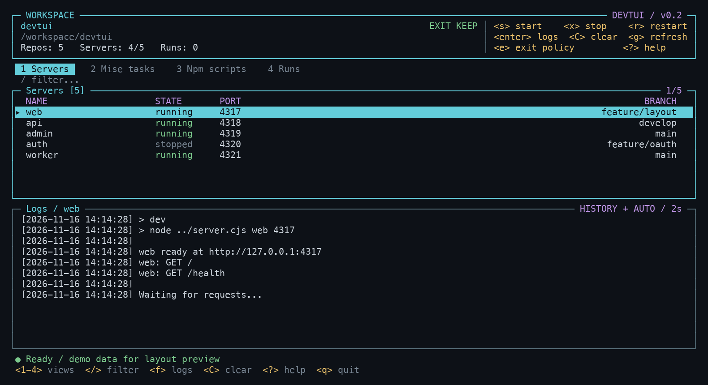
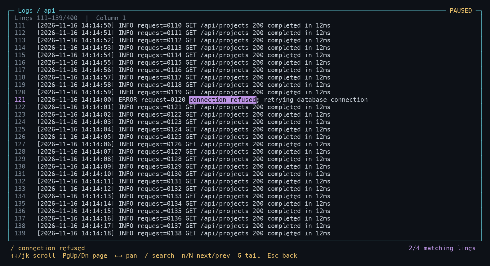

# devtui — 開発環境統合TUI MVP

複数repoのサーバー・miseタスク・npmスクリプトを、1つの端末画面から操作するプロトタイプです。Python標準ライブラリのみで動作します。

ワークスペース情報・リソース一覧・ログを枠線付きペインに分けた、k9s風のレイアウトです。選択行を強調し、稼働・失敗・停止を色分けします。上部と下部にはキー操作を常時表示します。



## 別PCで使う

Python 3.11以上（curses付き）・mise 2026.11.8以上・Gitを用意して、[SETUP.md](SETUP.md)の手順でclone・セットアップします。Python/mise/Node/pitchforkのバイナリ、実行ログ、DBデータ、認証情報はこのリポジトリに含めません。

このアプリ本体のライセンスは現時点では未指定です。外部ツールのライセンスと配布方針は[THIRD_PARTY_NOTICES.md](THIRD_PARTY_NOTICES.md)を参照してください。

## devtuiコマンドで起動

このフォルダで`./install`を実行すると、`~/.local/bin/devtui`にランチャーへのリンクを登録します。既存のコマンドは上書きしません。`~/.local/bin`がPATHに含まれていれば、どのディレクトリからでも呼べます。

```sh
devtui                        # 現在のディレクトリのmise.tomlを使う
devtui /path/to/workspace      # 指定ディレクトリのmise.tomlを使う
devtui ~/workspace/mise.toml   # 設定ファイルを直接指定しても可
devtui ~                      # ~/mise.tomlを使う（事前に設定を用意）
devtui --demo                 # このワークスペースの既存5台デモ
devtui --demo --inspect       # デモの設定確認のみ
```

引数のディレクトリを基準にrepo相対パスを解決し、呼び出し元のディレクトリをランチャーが勝手に変更することはありません。`--config`も引き続き使えますが、ディレクトリ引数とは併用できません。設定がない場合は、その場所と起動方法を案内します。

登録はこのソースフォルダへのリンクです。ソースを移動した場合はリンクを登録し直してください。別のbinディレクトリには`./install /path/to/bin`で登録できます。削除は登録した`devtui`リンクを外すだけです。

## このワークスペースですぐ試す

このフォルダで、通常の端末から実行します。

```sh
./try-demo
```

デモはweb/API/admin/auth/workerの5台で、`npm install`は不要です。`mise install`でこのPCに合うNode/pitchforkを用意します。起動にはlocalhostの4317〜4321番ポートを使用します。認証情報やDBデータは使いません。

`1`のサーバー（Servers）で選択して`s`を押すと起動します。`2`でmiseタスク、`3`でrepo別npmスクリプトを選び、Enterで実行します。ログと終了コードは`4`の実行履歴（Runs）で確認できます。

5台をまとめて起動する場合は、`2`のmiseタスク（Mise tasks）で`servers:start`を選びEnterを押します。中身は`mise daemons start --all`です。miseが一括起動を提供しているので、タスク定義はTUIやCLIから呼ぶための名前を付ける役割です。通常のセットアップでは`mise run servers:start`でも呼べます。

Serversは`NAME / STATE / PORT / BRANCH`の順で表示します。右端の`BRANCH`列は各repoの現在のGitブランチを右寄せで表示します。2秒ごとの状態取得時に読み直し、ブランチ名でも絞り込めます。Git管理外のフォルダや対応repoがないサーバーは`-`を表示します。デモのように同じGitリポジトリ内のフォルダを登録した場合は、そのリポジトリのブランチを表示します。ログは選択サーバーに自動追従し、`l`の操作は不要です。

```sh
./try-demo --inspect   # コマンドを実行せず設定とpackage.jsonを確認
./try-demo --doctor    # miseバージョン・サーバー・タスク一覧を確認
./try-demo --exit-policy stop
```

起動直後にサーバーを自動起動する機能はありません。

## 通常のセットアップ

必要環境: macOS/Linux、Python 3.11以上（curses付き）、mise 2026.11.8以上。デモのmise.tomlはpitchfork 2.33.1とNode 22.20.0を固定しています。Windowsは未対応です。

```sh
mise trust ./mise.toml
mise install
./run
```

`devtui --doctor`で互換性を確認できます。古いmiseを利用している場合は、使用するバージョンを更新してください。

別の作業ディレクトリを管理する場合:

```sh
./run --config /absolute/path/to/workspace/mise.toml
./run --mise /absolute/path/to/mise --config /absolute/path/to/workspace/mise.toml
```

ランチャーはPython 3.11以上を探します。`DEVTUI_PYTHON=/path/to/python3.13 ./run`でも指定できます。

## 操作

| キー | 操作 |
| --- | --- |
| `1`〜`4` / Tab | Servers / Mise tasks / Npm scripts / Runs |
| ↑↓ / `j` `k` | 項目選択 |
| `/` → 文字入力 → Enter | 現在の画面を絞り込み（日本語入力も可） |
| Esc | 入力中の絞り込みも解除し、通常のキー操作に戻る（Enterは絞り込みを適用して入力終了） |
| `s` / `x` / `r` | 選択サーバーの起動 / 停止 / 再起動 |
| サーバー選択（↑↓ / j k / 絞り込み） | 選択先のログを自動取得し、2秒ごとに更新 |
| `l`（Servers） | 選択サーバーのログを手動で再取得（通常は操作不要） |
| Enter / `f`（Servers / Runs） | 選択中のログを全画面で開く |
| `Shift+C`（Servers） | 選択サーバーの保存済みログを削除（稼働状態は変えず、削除後の新しい出力は表示） |
| Enter（Tasks / Npm） | タスク実行、Runsに切り替え |
| `c`（Runs） | 選択中の実行と子プロセスをキャンセル |
| PgUp / PgDn | ログのスクロール |
| `g` | package.jsonとmiseタスク一覧を再取得 |
| `e` | 終了時のKEEP / STOP切り替え |
| `?` | ヘルプ |
| `q` / Ctrl-C | 終了 |
| `L`（Shift + `l`） | 日本語／英語の表示を切り替え |

## 表示言語

`L`（Shift + `l`）で日本語／英語を切り替えます。全画面ログでも使用でき、切り替えはその起動中に有効です。検索・絞り込みの入力中は`L`も文字として扱います。

```sh
devtui /path/to/workspace --lang ja
devtui --demo --lang en
```

初期言語を保存する場合は、共通の`mise.toml`へ設定します。

```toml
[_.devtui]
language = "ja"  # ja / en
```

優先順位は`--lang`、`mise.toml`の`language`、未指定時の英語です。同梱デモは日本語を初期値にしています。メニュー・状態・操作ガイド・アプリの通知を翻訳し、repo名・ブランチ名・タスク定義の説明・コマンド・ログ本文は原文を表示します。CLIのヘルプと外部コマンド由来のエラーは言語切り替えの対象外です。

## 全画面ログ

ServersまたはRunsで対象を選び、Enterか`f`でログを全画面表示します。行番号付きで表示し、長い行は左右へスクロールできます。

| キー | 操作 |
| --- | --- |
| ↑↓ / `k` `j` | 1行ずつスクロール |
| トラックパッド / マウスホイール | 上下スクロール（対応する端末で、全画面ログ中のみ有効） |
| PgUp / PgDn | 1ページずつスクロール |
| Home / `g` | 取得済み履歴の先頭へ |
| End / `G` | 最新へ戻り、自動追従を再開 |
| ←→ / `h` `l` | 長い行を左右へスクロール |
| `/` → 文字入力 → Enter | ログ内を検索（大文字小文字を区別しない文字列検索、日本語可） |
| `n` / `N` | 次 / 前の一致行へ移動。末尾・先頭で折り返す |
| Space | 自動追従を一時停止 / 再開 |
| `L` | 日本語／英語を切り替え |
| `c` | 表示中の行のログ本文をクリップボードへコピー（横に隠れた部分も含む） |
| Option + `c` / `C`（Shift + `c`） | 上下に隠れた行も含め、読み込み済みの全ログをコピー |
| Esc / `q` / `f` | 元の一覧へ戻る。検索入力中のEscは入力と検索条件を解除 |

読み返し中に表示位置がずれないよう、スクロールや検索を始めると`PAUSED`になり、表示対象のログを固定します。サーバーやタスク自体は継続します。`G`かSpaceで`FOLLOW`へ戻ると新しい出力を取り込みます。検索語はハイライトし、画面外の長い行に一致した場合は横方向の表示位置も調整します。

トラックパッドは、端末がジェスチャーをマウスホイールイベントとしてアプリへ渡す場合に動作します。SGRマウス報告とcursesのマウスイベントを扱い、古いmacOSのcursesでも上下方向を読み取ります。端末・SSH・tmux等の設定によりイベントが届かない場合は、↑↓やPgUp/PgDnを使えます。全画面ログを閉じると、アプリによるマウス入力の受け取りも解除します。

サーバーの全画面表示では保存済みログの直近最大5,000行を取得します。通常ペインは直近150行です。RunsはTUIがメモリに保持している最大1,500行を参照します。上限を超えた履歴やTUI終了後のタスク出力は、この画面の検索対象に含まれません。

コピーはmacOSの`pbcopy`を使うため、iTerm2・純正Terminalとも同じ操作で利用できます。行番号・枠線・検索ハイライトは含めず、行の本文を改行区切りでコピーします。全ログコピーの対象は現在の読み込み済みスナップショットで、保存上限より前の履歴や`PAUSED`中に新しく出たログは含めません。検索条件はコピー対象の行を絞り込みません。検索入力中の`c`は検索文字として扱います。

Option + `c`はMetaの`ESC c`と、macOSの一般的なキーボード配列が生成する`ç`の両方に対応します。独自のキーマッピング等で動作しない場合は`Shift + c`を使ってください。SSH経由では、devtuiを実行しているMac側のクリップボードが対象です。



端末サイズは68列×16行以上。複数タスクは並行実行できます。同じ操作の多重実行と、サーバー制御コマンド同士の競合は抑止します。

**KEEP**ではpitchforkのサーバーを継続します。**STOP**では指定した`mise.toml`の`[daemons]`全件を停止します。TUI起動前から動いていた対象サーバーも含みます。別プロジェクトを参照するdaemonの依存先は停止対象に含めません。どちらの設定でも、TUIが実行した通常タスクは終了時にキャンセルします。設定の切り替えはその起動中のみ有効です。

デモをKEEPで終了した後に停止する場合は、`./try-demo --exit-policy stop`を起動して`q`で終了してください。通常セットアップなら、このフォルダで`mise daemons stop`からも停止できます。

## 単一mise.tomlの設定

```toml
min_version = "2026.11.8"

[settings]
experimental = true

[tools]
node = "22.20.0"
pitchfork = "2.33.1"

# miseが無視する公式の自由データ領域を利用
[_.devtui]
exit_policy = "keep"
language = "ja"

[_.devtui.repos.frontend]
path = "../frontend"  # このmise.tomlからの相対パス、絶対パス、~/も可
# package_manager = "yarn"  # 自動判定を上書きする場合のみ
# daemons = ["frontend"]   # repo名とサーバー名が異なる場合などに明示

[_.devtui.repos.backend]
path = "../backend"

[daemons_settings]
namespace = "my-development-stack"  # 別環境と重複させない

[daemons.frontend]
dir = "../frontend"
run = "exec yarn run start"
port = 3000
ready_port = 3000
proxy = false

[tasks.lint-all]
description = "Lint the system"
run = "./scripts/lint-all.sh"
```

repoの一覧は`[_.devtui.repos]`、長時間稼働するコマンドはmise標準の`[daemons]`、共通タスクは`[tasks]`に置きます。repoのパスとdaemonの作業ディレクトリは用途が異なるため、それぞれ明示します。npmスクリプトのコマンド本体は複製せず、各repoの`package.json`から読みます。

ブランチ表示では、repo名と同じ名前のサーバーを自動対応付けします。名前が異なる場合や1つのrepoから複数サーバーを動かす場合は、repo設定に`daemons = ["api", "worker"]`のように記述します。表示はディスク上の現在のチェックアウトであり、サーバー起動時点のブランチを記録したものではありません。detached HEADは`detached@<短いコミットID>`と表示します。Git未導入・読取失敗・Git外のディレクトリは`-`です。

パッケージマネージャーの判定順:

1. repo設定の`package_manager`
2. package.jsonの`packageManager`
3. lockfile（npm / yarn / pnpm / bun。複数種類は設定エラー）
4. npm

npmスクリプトはルートmiseの環境を読み、対象repoに移動して`<manager> run <script>`を実行します。兄弟repo内のmise設定はこの経路では読み込みません。必要なYarn/pnpm等はルートの`[tools]`などで利用可能にしてください。Corepackのダウンロード確認など、対話が必要な準備は先に端末で済ませます。

## 実装範囲と制約

- サーバーの監督・readiness・永続化・ログ保管はmise/pitchforkに委譲。独自の常駐プロセスマネージャーはありません。
- 状態取得は2秒間隔、サーバーログは通常150行、全画面表示では最大5,000行のスナップショットです。ログは過去の起動履歴も含み、`[日時]`付きで表示します。`HISTORY + AUTO`は保存済み履歴を含む自動追従を意味します。初回表示・選択変更時に自動で取得し、Servers以外の画面や全画面で履歴を読んでいる間は新しいサーバーログの取得を止めます。更新時は表示を置き換え、同じスナップショットを追加しません。サーバー制御は120秒でタイムアウトします。開始コマンドがタイムアウトした場合も、pitchfork側でサーバーが継続している可能性があるため一覧で確認してください。
- 通常タスクは非対話実行で標準入力を閉じます。`raw`/`interactive`なmiseタスクは一覧に表示しますが、実行時に端末からの起動を案内します。引数入力・npm workspace単位の列挙は未対応です。
- タスクログはメモリ内で各1500行、終了済み実行は直近100件まで保持します。履歴はTUI再起動で消えます。サーバーログはpitchfork側に残ります。
- repo情報・daemon操作対象は指定した生の`mise.toml`から読みます。include・overlay・テンプレートによるrepoメタデータの解決は未対応。repo/daemon定義変更はTUIを再起動してください。mise自身は標準の設定継承に従います。
- `MISE_ENV`等の設定ファイル選択変数が有効な場合は、誤った構成の操作を避けるため起動時に案内します。
- DBの起動・dump/restore・IT専用環境・Git画面は未実装です。DBを触る専用処理はありません。既存miseタスクはそのまま実行可能なので、タスク自体の作用は定義に従います。
- 正常終了・Ctrl-Cで終了処理を行います。SIGKILLやマシン停止時のクリーンアップ保証はありません。

## 次の段階

Phase 2では、IT専用PostgreSQLコンテナを作成し、`trap`による終了処理を持つ1つのCLIワークフローを先に検証します。TUIはそのmiseタスクを呼ぶだけにし、開発DBの退避・書き換え・復元は初期実装に含めません。Phase 3はrepo横断のGit状態表示から始めます。

## 検証

```sh
./run-tests
./run --inspect
```

実際のmise/pitchforkと端末キー操作を使った確認結果は[VERIFICATION.md](VERIFICATION.md)に記録しています。

### スクロールの互換性

macOSの古いncursesとSGRマウスを指定する端末定義の組み合わせでは、curses内で下方向等の入力が失われる場合があります。devtuiではSGRをcursesのマウス変換より先に読み取り、`BUTTON5_PRESSED`のない環境でも上下左右を処理します。ナビゲーションキーは端末定義と標準の矢印・Home/End・PageUp/PageDownの配列を使って読み取ります。

公式仕様: [mise daemons](https://mise.jdx.dev/daemons.html)、[miseの自由データ領域](https://mise.jdx.dev/configuration/reference.html#_)、[pitchforkのmise連携](https://pitchfork.jdx.dev/guides/mise-integration.html)。daemon連携は実験的機能のため、互換性を検証したバージョンを明示しています。
